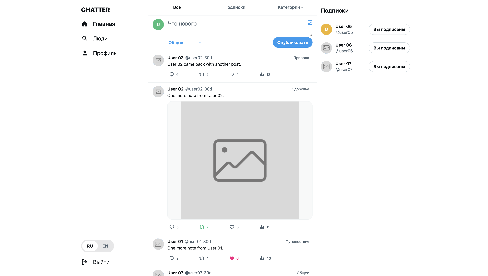
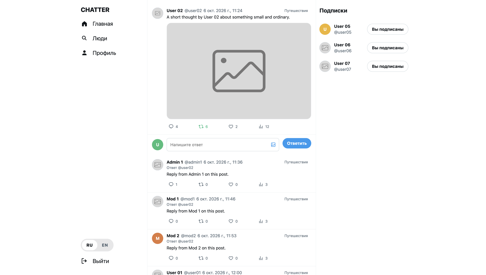
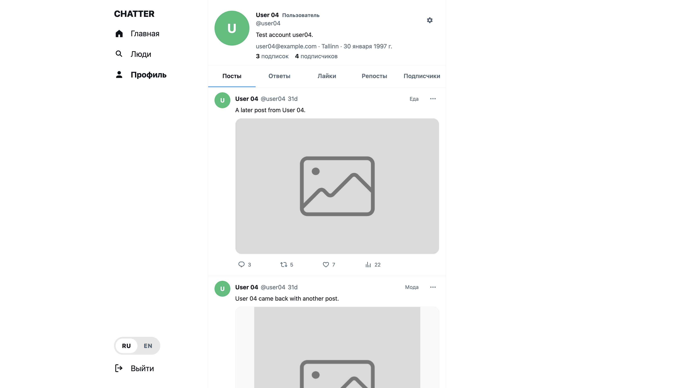
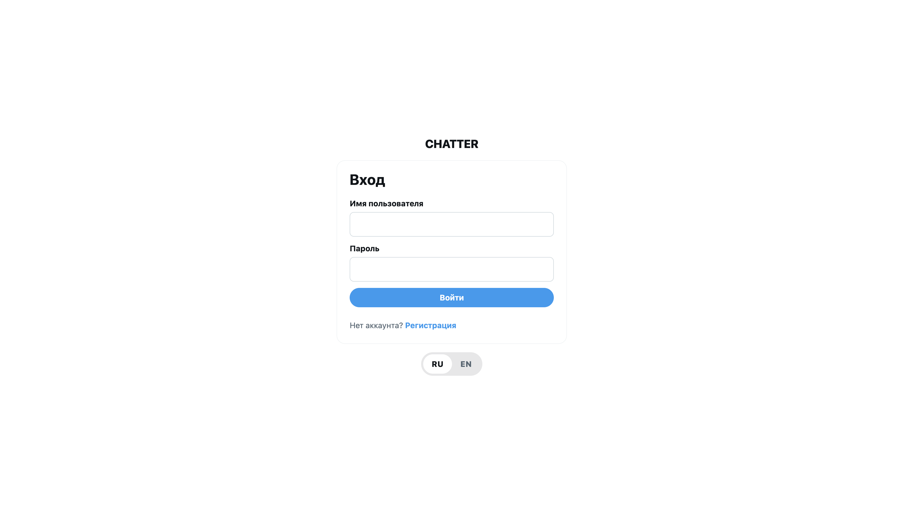
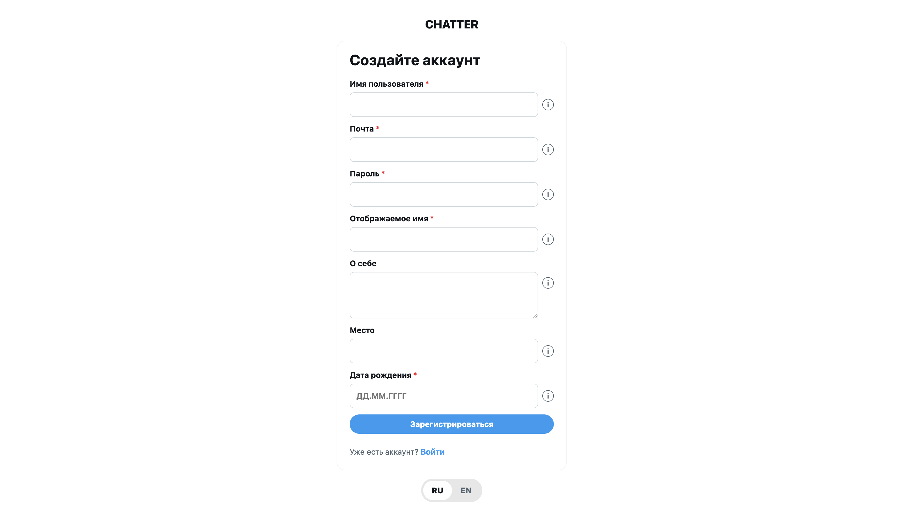
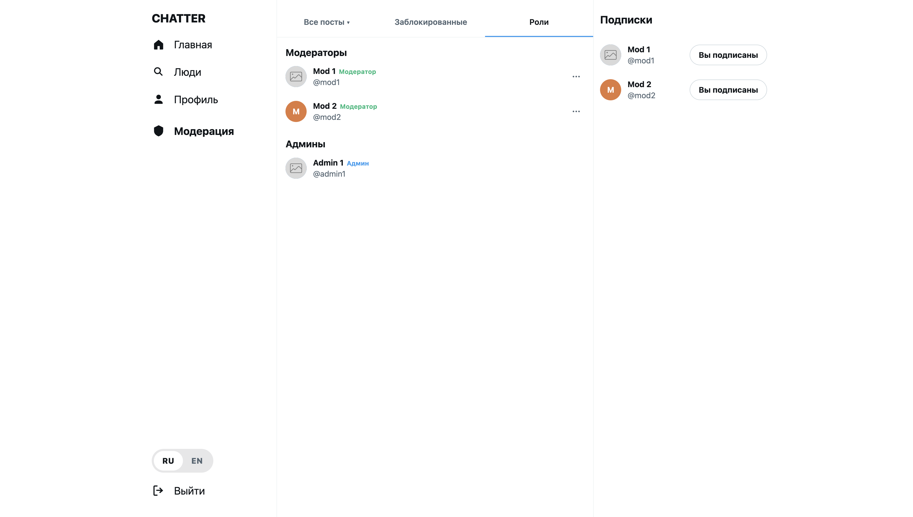

# Chatter

**Chatter** — веб-приложение для публикации коротких постов и взаимодействия между пользователями. Поддерживает ответы на публикации, лайки, репосты, подписки, просмотр ленты и профилей пользователей. Предусмотрены инструменты модерации контента и управления пользователями.

## Содержание

- [Стек технологий](#стек-технологий)
- [Функциональность](#функциональность)
- [Требования](#требования)
- [Запуск](#запуск)
- [Использование](#использование)
- [Пользовательский интерфейс](#пользовательский-интерфейс)
- [API](#api)
- [Скриншоты](#скриншоты)
- [Структура проекта](#структура-проекта)
- [Автор](#автор)

## Стек технологий

- Java 21, Spring Boot 4.1
- Spring Web, Spring Data JPA, Spring Security, Spring Validation, Hibernate
- PostgreSQL, Liquibase
- JWT
- MapStruct, Lombok, Apache Tika
- Springdoc OpenAPI, Swagger UI
- Maven
- JUnit 5, Testcontainers
- HTML, CSS, JavaScript
- Docker Compose

## Функциональность

**Пользователи:**
- Регистрация и авторизация с использованием JWT.
- Управление профилем и аватаром.
- Создание постов с выбором категории и добавлением фотографии.
- Публикация ответов на посты и комментарии. Ответы также являются постами.
- Лайки, репосты.
- Счётчик просмотров увеличивается при открытии поста.
- Подписка на других пользователей.
- Общая лента постов и лента публикаций пользователей, на которых подписан пользователь.
- Просмотр постов по категориям.

**Модераторы:**
- Просмотр постов.
- Скрытие и восстановление постов.
- Блокировка и разблокировка пользователей.

**Администраторы:**
- Права модератора: просмотр, скрытие и восстановление постов, блокировка и разблокировка пользователей.
- Назначение ролей пользователям.

## Требования

- Для запуска через Docker Compose необходим Docker с поддержкой Docker Compose.

- Для запуска приложения из IDE потребуются:
  - Java 21 (Maven Wrapper включён в репозиторий: `./mvnw`, на Windows — `mvnw.cmd`).
  - PostgreSQL 16+.

## Запуск

### Запуск через Docker Compose

В корне проекта создай файл `.env` со следующими переменными:

```env
DB_USERNAME=postgres
DB_PASSWORD=пароль
JWT_SECRET=секрет_в_base64
```

`JWT_SECRET` — Base64-представление случайного секрета длиной не менее 32 байт. Получить такую строку можно командой:

```bash
openssl rand -base64 32
```

Вставь полученную строку целиком в переменную JWT_SECRET. `DB_URL` указывать не нужно: адрес базы данных передаётся контейнеру автоматически через Docker Compose.

Сборка и запуск:

```bash
# Запуск с выводом логов в терминал
docker compose up --build

# Запуск в фоновом режиме
docker compose up --build -d
```

### Запуск из IDE

Создай базу данных chatter_db и настрой переменные окружения DB_USERNAME, DB_PASSWORD и JWT_SECRET. `DB_URL` можно не указывать, если используется адрес по умолчанию:

`jdbc:postgresql://localhost:5432/chatter_db`

Запуск приложения:

```bash
./mvnw spring-boot:run
```

Для запуска веб-интерфейса используй отдельный веб-сервер. Выполни команды из корня проекта:

```bash
cd frontend
python3 -m http.server 5500
```

### Запуск тестов

```bash
./mvnw test
```

Для тестов используется Testcontainers, который автоматически запускает PostgreSQL в Docker-контейнере. При стандартной конфигурации Testcontainers для этого нужен работающий Docker.

## Использование

После запуска приложение будет доступно по адресам:

- Веб-интерфейс: http://localhost:5500 или http://127.0.0.1:5500

При запуске приложения Liquibase автоматически применяет миграции базы данных, включая миграции с начальными данными.

Тестовые учётные записи:

- Пользователи: `user01`–`user05`, `user06` (заблокирован), `user07` (заблокирован)
- Модераторы: `mod1`, `mod2`
- Администратор: `admin1`

Пароль для всех учётных записей: `pass1234`.

Тестовые учётные записи предназначены только для демонстрации.

## Пользовательский интерфейс

- Общая лента постов, лента подписок и категории.
- Страница поста с ответами.
- Профили пользователей, настройки и список пользователей.
- Страницы входа и регистрации.
- Интерфейс модерации для модераторов и администраторов.

## API

Все запросы, кроме регистрации, авторизации и получения аватара, требуют заголовка:

`Authorization: Bearer <token>`

Основные группы эндпоинтов:

- `auth`
- `users`
- `posts`
- `likes`
- `reposts`
- `subscriptions`

Полная документация API доступна в [Swagger UI](http://localhost:8080/swagger-ui/index.html).

## Скриншоты

### Лента



Три раздела: все посты, публикации авторов, на которых оформлена подписка, и категории. Справа отображается блок с подписками.

### Пост



Страница поста с фотографией, ответами и формой для добавления ответа.

### Профиль



Профиль пользователя со вкладками постов, ответов, лайков, репостов и подписчиков.

### Вход



Страница авторизации.

### Регистрация



Страница регистрации нового пользователя.

### Модерация



Раздел управления ролями пользователей

## Структура проекта

```text
src/main/java/com/kolyvanova/chatter
├── auth            # Регистрация и авторизация
├── user            # Пользователи, роли и статусы
├── post            # Посты, ответы, лента и модерация
├── like            # Лайки
├── repost          # Репосты
├── subscription    # Подписки
├── image           # Проверка и хранение изображений
├── security        # JWT и настройки безопасности
└── exception       # Обработка исключений

frontend              # Страницы веб-приложения

src/main/resources/db/changelog  # Миграции Liquibase

media                 # Аватары (avatar/) и фото постов (post/)
```

## Автор

Мария Колыванова — [GitHub](https://github.com/MariaKolyvanova)